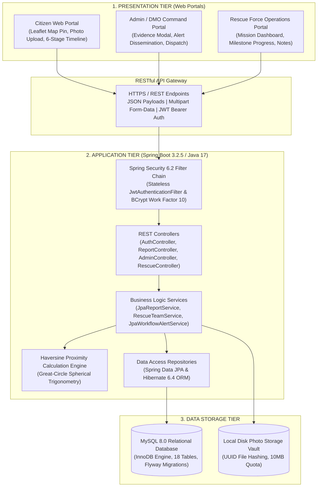
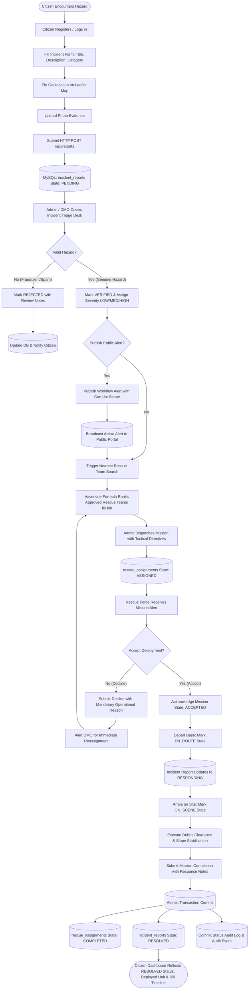
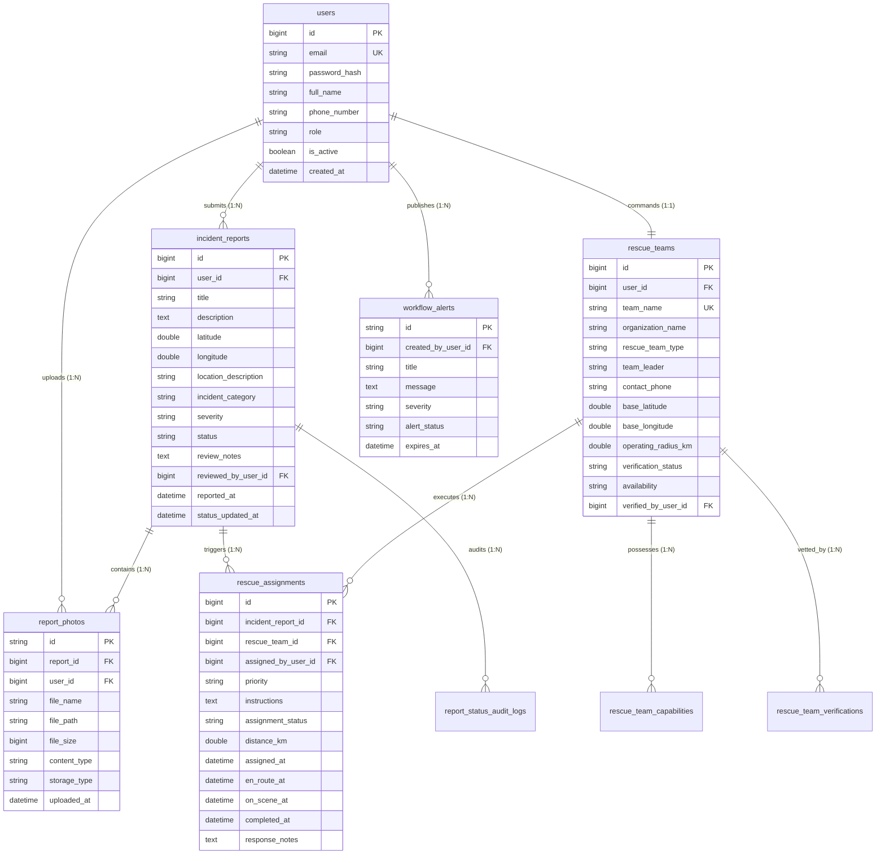

<div align="center">

# SLOPEGUARD
### Landslide Incident Reporting and Rescue Coordination System

**Report • Verify • Alert • Rescue • Stay Safe**

[](https://openjdk.org/)
[](https://spring.io/projects/spring-boot)
[-6DB33F?logo=springsecurity&logoColor=white)](https://spring.io/projects/spring-security)
[-4479A1?logo=mysql&logoColor=white)](https://www.mysql.com/)
[](https://flywaydb.org/)
[](https://leafletjs.com/)
[-brightgreen)](https://github.com/)

</div>

---

## 📑 Table of Contents

- [Quick Start Navigation](#-quick-start-navigation)
- [Problem Statement](#-problem-statement)
- [Proposed Solution](#-proposed-solution)
- [Complete Project Description](#-complete-project-description)
- [Key Features by Module](#-key-features-by-module)
- [Technology Stack](#-technology-stack)
- [System Architecture](#-system-architecture)
- [Complete System Flow Diagram](#-complete-system-flow-diagram)
- [Module-Wise Explanation](#-module-wise-explanation)
  - [1. Citizen Module](#1-citizen-module)
  - [2. Admin / DMO Command Module](#2-admin--dmo-command-module)
  - [3. Rescue Force Operations Module](#3-rescue-force-operations-module)
- [Database Overview & ER Diagram](#-database-overview--er-diagram)
- [RESTful API Reference](#-restful-api-reference)
- [Authentication and Security Design](#-authentication-and-security-design)
- [Installation and Local Setup Guide](#-installation-and-local-setup-guide)
- [Running the Application](#-running-the-application)
- [Project Folder Structure](#-project-folder-structure)
- [Testing and Validation Evidence](#-testing-and-validation-evidence)
- [System Limitations](#-system-limitations)
- [Future Enhancements](#-future-enhancements)
- [Project Impact](#-project-impact)
- [Contributors and Acknowledgements](#-contributors-and-acknowledgements)

---

## ⚡ Quick Start Navigation

| Interested In | Direct Section Link |
| :--- | :--- |
| **Architectural Overview** | [Jump to System Architecture](#-system-architecture) |
| **Interactive Workflow** | [Jump to Complete System Flow Diagram](#-complete-system-flow-diagram) |
| **Step-by-Step Setup** | [Jump to Installation & Local Setup](#-installation-and-local-setup-guide) |
| **API Endpoints** | [Jump to RESTful API Reference](#-restful-api-reference) |
| **Database Schema** | [Jump to Database Overview & ER Diagram](#-database-overview--er-diagram) |
| **Testing Verification** | [Jump to Testing & Validation Evidence](#-testing-and-validation-evidence) |

---

## 🚨 Problem Statement

In mountainous, geologically fragile terrains such as the Western Ghats, Nilgiris, and Himalayan corridors, severe monsoon downpours and seismic shifts trigger sudden slope destabilizations, rockfalls, mudslides, and debris flows. These events routinely sever critical transportation arteries, trap commuters, and isolate remote settlements.

Traditional emergency reporting mechanisms suffer from four critical operational bottlenecks:

1. **Fragmented & Unverified Channels:** Ground observations are scattered across overwhelmed emergency telephone helplines (100, 108, 112) or informal social media posts. Telephone calls frequently lack geographical precision in remote switchbacks, while social media feeds are plagued by misinformation, unvetted rumors, and outdated archival imagery.
2. **Administrative Triage Bottlenecks:** District Disaster Management Authorities (DDMA) lack a consolidated operational picture. Officers must manually cross-verify phone reports, losing valuable hours assessing whether an obstruction requires local road gravel clearance or specialized heavy search-and-rescue machinery.
3. **Delayed & Unoptimized Rescue Mobilization:** Specialized emergency squads (SDRF, NDRF, Fire & Rescue) are dispatched manually via sequential telephone calls. Without automated spatial distance calculations, authorities frequently deploy distant units while closer, appropriately equipped squads remain idle.
4. **Informational Vacuum (Open-Loop Communication):** Once a citizen submits an emergency report, they receive zero feedback on whether their report was verified or if rescue forces were deployed, fostering widespread panic among stranded motorists.

SlopeGuard directly resolves these challenges by establishing a **centralized, closed-loop disaster reporting, verification, community alert, and proximity-based rescue coordination platform**.

---

## 💡 Proposed Solution

SlopeGuard replaces ad-hoc reporting with a robust, enterprise-grade web application orchestrating three primary operational user roles:

```
┌─────────────────┐       ┌─────────────────┐       ┌─────────────────┐
│     CITIZEN     │       │   ADMIN / DMO   │       │  RESCUE FORCE   │
├─────────────────┤       ├─────────────────┤       ├─────────────────┤
│ • Geotagged GPS │       │ • Evidence Exam │       │ • Mission Intake│
│ • Photo Upload  │──────►│ • Severity (L/M)│──────►│ • Accept/Decline│
│ • Status Badges │       │ • Official Alert│       │ • Milestones    │
│ • Rescue Notes  │◄──────│ • Haversine GPS │◄──────│ • Complete & Sync│
└─────────────────┘       └─────────────────┘       └─────────────────┘
```

1. **Citizen:** Stranded motorists and local residents submit geo-tagged incident reports accompanied by multi-part photographic evidence and track rescue progress through an interactive 6-stage operational timeline.
2. **Admin / District Management Officer (DMO):** Evaluates incoming photographic evidence, assigns severity (`LOW`, `MEDIUM`, `HIGH`), verifies or rejects submissions, publishes authoritative community alerts, and dispatches the nearest eligible rescue squad using the Haversine distance formula.
3. **Rescue Team:** Vetted emergency squads (SDRF, NDRF, Fire & Rescue) receive mission dispatches, acknowledge deployment (`ACCEPTED`), log discrete milestones (`EN_ROUTE`, `ON_SCENE`), and submit operational completion remarks (`COMPLETED`).

An atomic `@Transactional` backend synchronizer guarantees that rescue mission completion immediately transitions the citizen's incident report to `RESOLVED`, rendering deployed squad callsigns, completion timestamps, and tactical response notes directly in the citizen's personal dashboard.

---

## 📖 Complete Project Description

SlopeGuard is an integrated, full-stack disaster management web application designed for high resilience and rapid communication. 

### Information Movement Lifecycle
1. **Report Ingestion:** A citizen selects their exact location on an interactive Leaflet/OpenStreetMap interface and uploads high-resolution photographic evidence. The Spring Boot backend sanitizes the payload, validates image constraints (JPEG/PNG/WebP under 10MB), persists the file with a unique UUID hash, and commits the report to MySQL with an initial status of `PENDING`.
2. **Administrative Triage:** The DMO accesses an administrative command desk displaying live aggregate metrics. Selecting a report launches a modal displaying the photo gallery and geospatial coordinates. The DMO assigns severity, verifies the incident (`VERIFIED`), and can publish an official public workflow alert to warn travelling motorists along that corridor.
3. **Proximity-Based Rescue Dispatch:** To mobilize assistance, the DMO queries the nearest rescue team engine. The backend evaluates the great-circle Haversine formula across approved, available rescue units, ranking them by spherical distance in kilometres. The DMO dispatches the mission with tactical instructions.
4. **Field Mission Execution:** The deployed unit receives the mission on its dedicated dashboard, accepts deployment, and updates progress (`EN_ROUTE` -> `ON_SCENE`). When debris is cleared and slope stability is confirmed, the commander submits completion notes.
5. **Closed-Loop Resolution:** The backend executes an atomic transaction: the mission is marked `COMPLETED`, the incident report is updated to `RESOLVED`, status audit logs are committed, and the reporting citizen's dashboard reflects complete 6/6 timeline checkmarks.

---

## 🌟 Key Features by Module

### 👤 Citizen Module
- **Registration & Authentication:** BCrypt password encryption, stateless JWT authentication, and automated client-side route guards.
- **Geotagged Incident Reporting:** Interactive Leaflet.js map coordinate picker automatically populating decimal latitude and longitude.
- **Multi-Part Photographic Evidence:** Multi-image upload dropzone with client-side file size and MIME-type validation.
- **Hazard Categorization:** Standardized geotechnical classifications (`LANDSLIDE`, `ROCKFALL`, `MUD_SLIDE`, `DEBRIS_FLOW`, `ROAD_BLOCKAGE`, `OTHER`).
- **Live "My Reports" Tracking:** Personal dashboard with color-coded status badges (`PENDING`, `VERIFIED`, `REJECTED`, `ASSIGNED`, `RESPONDING`, `RESOLVED`).
- **Rescue Completion Synchronization:** When a rescue team completes an assignment, the citizen report view displays the deployed rescue team name, completion timestamp, operational completion remarks, and all 6/6 timeline checkmarks.
- **Authoritative Public Alerts:** Real-time alert feed displaying official warnings published by district authorities.

### 🛡️ Admin / DMO Command Module
- **Operational Triage Center:** Centralized command dashboard with live metric counters (Pending Reports, Verified Incidents, Active Alerts, Registered Rescue Teams).
- **Visual Evidence Inspection Modal:** Modal dialog for evaluating submitted photographs, geospatial markers, and reporter notes.
- **Verification Workflow:** One-click report verification (`VERIFIED`) or rejection (`REJECTED`) with mandatory justification.
- **Hazard Severity Classification:** Standardized severity categorization (`LOW`, `MEDIUM`, `HIGH`) establishing operational priority.
- **Official Public Alert Dissemination:** Full alert lifecycle management (Draft, Publish, Resolve, Cancel) with defined geographic corridor scopes and expiration timestamps.
- **Rescue Team Vetting:** Administrative review and approval/rejection of registered emergency rescue squads.
- **Haversine Nearest Team Calculator:** Algorithmic calculation ranking approved rescue bases by spherical distance (in km) to the hazard site.
- **Tactical Mission Dispatch:** One-click mission assignment specifying priority level (`LOW`, `MEDIUM`, `HIGH`, `CRITICAL`) and tactical operational directives.

### 🚒 Rescue Force Operations Module
- **Organizational Profile Registration:** Agency registration specifying team type (`SDRF`, `NDRF`, `FIRE_AND_RESCUE`, `CIVIL_DEFENSE`, `VOLUNTEER`), base coordinates, operating radius, and equipment capabilities.
- **Mission Intake Cockpit:** Dedicated operational dashboard displaying dispatched assignments, hazard descriptions, coordinates, and DMO instructions.
- **Acceptance Protocol:** Formal deployment acceptance (`ACCEPTED`) or rejection (`DECLINED`) with mandatory operational reason (alerting DMO for immediate reassignment).
- **Discrete Milestone Updates:** Progressive state check-ins (`EN_ROUTE` departure timestamp, `ON_SCENE` arrival timestamp) updating the parent report status to `RESPONDING`.
- **Mission Completion & Response Notes:** Enforces non-blank tactical remarks upon clearance, atomically resolving the parent incident report.

---

## 💻 Technology Stack

SlopeGuard is built upon a verified, production-grade technology matrix:

| Layer | Component | Version / Specification | Justification |
| :--- | :--- | :--- | :--- |
| **Frontend** | HTML5 / CSS3 / Vanilla JavaScript | ECMAScript 2022 (ES6+) | Lightweight footprint (< 40KB initial load); eliminates heavy SPA framework overhead over degraded mountain networks. |
| **Styling** | Design Tokens / Responsive CSS | Custom CSS3 Variables | High-contrast emergency visual hierarchy; fluid responsive grid across mobile and desktop viewports. |
| **Mapping Engine** | Leaflet.js | v1.9.4 | Mobile-optimized interactive mapping; zero API licensing costs; accurate coordinate capture. |
| **Cartography Provider**| OpenStreetMap (OSM) / CartoDB | Standard Raster Tiles | Open-access, globally accurate geospatial cartography without proprietary cloud billing quotas. |
| **Backend Runtime** | Java Development Kit (JDK) | Java 17 LTS (Eclipse Temurin) | Long-Term Support enterprise runtime; strong static type safety and enhanced garbage collection. |
| **Backend Framework** | Spring Boot | v3.2.5 | Production-grade framework providing embedded Tomcat 10, Dependency Injection, and automated configuration. |
| **Security Framework** | Spring Security | v6.2.4 | Stateless security filter chain enforcing Role-Based Access Control (`CITIZEN`, `ADMIN`, `RESCUE_FORCE`). |
| **Authentication** | JSON Web Token (JWT) | `io.jsonwebtoken:jjwt:0.11.5` | Cryptographically signed, stateless Bearer authentication tokens using HMAC-SHA256 (`HS256`). |
| **Password Security** | BCrypt Password Encoder | Work Factor 10 | Adaptive cryptographic salting and hashing algorithm protecting user credentials from brute-force exposure. |
| **ORM / Persistence** | Spring Data JPA / Hibernate | Hibernate 6.4.4.Final | Strongly typed ORM mapping relational tables to Java domain models; automated query synthesis and HikariCP connection pooling. |
| **Database Engine** | MySQL Community Server | v8.0.40 (InnoDB Engine) | ACID-compliant relational storage; foreign key referential integrity, B-tree indexing, and high-concurrency transaction isolation. |
| **Database Migrations**| Redgate Flyway Community | v9.22.3 | Version-controlled, deterministic database schema evolution across migrations `V1`, `V100`, and `V101`. |
| **Validation Layer** | Jakarta Bean Validation | Hibernate Validator 8.0.1 | Declarative payload validation (`@NotNull`, `@Size`, `@DecimalMin`, etc.) neutralizing malformed HTTP requests at the controller boundary. |
| **Storage Subsystem** | Multi-Part Disk Vault | Servlet 3.0 Multi-Part | Secure multi-part binary ingestion with UUID hashing, MIME validation, and file-size quota enforcement. |

---

## 🏗️ System Architecture

SlopeGuard implements a clean, decoupled **3-Tier Enterprise Client-Server Architecture**:



---

## 🔄 Complete System Flow Diagram

The complete operational lifecycle from ground observation to administrative verification, rescue dispatch, milestone execution, and citizen resolution:



---

## 🧩 Module-Wise Explanation

### 1. Citizen Module
- **Purpose:** Democratizes hazard reporting by equipping stranded citizens and travellers with a direct digital conduit to district authorities.
- **Main Operations:** User registration, JWT login, incident report creation with interactive Leaflet map pin placement, multi-part photo uploads, and personal tracking via the "My Reports" dashboard.
- **Important Data Handled:** Decimal GPS coordinates (latitude, longitude), location descriptors, hazard categories, image binary files, and personal contact details.
- **Interactions:** Ingests reports into the central MySQL database, triggers triage notifications for the DMO, and visualizes real-time status updates and official alerts published by authorities.


### 2. Admin / DMO Command Module
- **Purpose:** Functions as the digital command center for District Disaster Management Officers (DMO) and emergency coordinators.
- **Main Operations:** Triage queue inspection, photographic evidence verification, severity classification (`LOW`, `MEDIUM`, `HIGH`), official workflow alert publication, rescue squad registration vetting, and proximity-based dispatch.
- **Important Data Handled:** Aggregate incident statistics, review notes, public alert message corridors and expiry schedules, rescue squad base coordinates, and tactical dispatch instructions.
- **Interactions:** Verifies citizen reports, computes Haversine distances against the rescue team registry, issues mission directives to rescue squads, and disseminates public advisories.

<div align="center">

  
*Figure: Admin / DMO Incident Triage Command Desk & Real-Time Metrics Overview*

<br/>

  
*Figure: Haversine Proximity-Based Rescue Team Assignment Interface*

</div>

### 3. Rescue Force Operations Module
- **Purpose:** Manages the operational execution and milestone progression of physical emergency rescue squads in the field.
- **Main Operations:** Squad profile registration (organization type, base coordinates, equipment capabilities), mission intake inspection, deployment acceptance/decline decisions, milestone reporting (`EN_ROUTE`, `ON_SCENE`), and completion remarks submission.
- **Important Data Handled:** Organizational details, 24/7 dispatch phone, operational radius, mission decline reasons, milestone departure/arrival timestamps, and site clearance response notes.
- **Interactions:** Receives assignments from the DMO and executes atomic transactional updates that resolve the linked citizen incident report upon mission conclusion.

<div align="center">

  
*Figure: Rescue Force Operations Cockpit & Active Disaster Assignments*

<br/>

  
*Figure: Rescue Mission Completion Interface & Atomic Citizen Status Synchronization to RESOLVED*

</div>

---

## 🗄️ Database Overview & ER Diagram

SlopeGuard utilizes **MySQL 8.0 (InnoDB Engine)** managed through version-controlled **Flyway migrations** (`V1`, `V100`, `V101`). The database maintains 18 normalized tables enforcing strict referential integrity.

### Core Entity Relationship Diagram



### Table Summary & Primary Foreign Keys

| Table Name | Engine | Columns | Primary Key | Foreign Key Dependencies | Constraints & Indexes |
| :--- | :---: | :---: | :--- | :--- | :--- |
| `users` | InnoDB | 9 | `id` (BIGINT AUTO) | None | `uk_users_email` (`email` UNIQUE) |
| `incident_reports` | InnoDB | 15 | `id` (BIGINT AUTO) | `fk_incident_reports_user` -> `users(id)` | Spatial index on (`latitude`, `longitude`) |
| `report_photos` | InnoDB | 9 | `id` (VARCHAR 64 UUID)| `fk_report_photos_report` -> `incident_reports(id)` | `ON DELETE CASCADE` |
| `rescue_teams` | InnoDB | 20 | `id` (BIGINT AUTO) | `fk_rescue_teams_user` -> `users(id)` | `team_name` UNIQUE, `user_id` UNIQUE |
| `rescue_team_capabilities` | InnoDB | 3 | `id` (BIGINT AUTO) | `fk_rt_cap_team` -> `rescue_teams(id)` | `uk_team_capability` UNIQUE |
| `rescue_assignments` | InnoDB | 18 | `id` (BIGINT AUTO) | `fk_ra_incident`, `fk_ra_team`, `fk_ra_assigner` | Indexed on `assignment_status` |
| `workflow_alerts` | InnoDB | 16 | `id` (VARCHAR 64 UUID)| `fk_wf_alert_creator` -> `users(id)` | Indexed on `alert_status`, `severity` |
| `report_status_audit_logs` | InnoDB | 8 | `id` (BIGINT AUTO) | `fk_status_audit_report` -> `incident_reports(id)` | Immutable historical state transition log |
| `audit_events` | InnoDB | 10 | `id` (VARCHAR 64 UUID)| None (Loosely coupled for audit immutability) | Indexed on `actor_user_id`, `created_at` |

---

## 📡 RESTful API Reference

All SlopeGuard APIs communicate over HTTP/HTTPS, accept and produce `application/json;charset=UTF-8` (or `multipart/form-data` for uploads), and enforce Role-Based Access Control via `Authorization: Bearer <JWT>`.

### Authentication & Profile APIs
| Method | Endpoint URI | Required Role | Request Payload | Description |
| :---: | :--- | :---: | :--- | :--- |
| `POST` | `/api/auth/register` | Public | JSON: `fullName`, `email`, `password`, `phone`, `role` | Registers citizen or rescue account; returns JWT token. |
| `POST` | `/api/auth/login` | Public | JSON: `email`, `password` | Authenticates credentials; returns Bearer JWT. |
| `POST` | `/api/auth/forgot-password` | Public | JSON: `email` | Generates secure password reset token. |
| `POST` | `/api/auth/reset-password` | Public | JSON: `token`, `newPassword` | Consumes token and resets password hash. |
| `GET` | `/api/user/profile` | Authenticated | None (Token header) | Retrieves authenticated user account details. |

### Citizen Incident Reporting APIs
| Method | Endpoint URI | Required Role | Request Payload | Description |
| :---: | :--- | :---: | :--- | :--- |
| `POST` | `/api/reports` | `ROLE_CITIZEN` | JSON: `title`, `description`, `latitude`, `longitude`, `category` | Submits incident report (Status: `PENDING`). |
| `POST` | `/api/reports/{id}/photos` | `ROLE_CITIZEN` | Multipart Form-Data: `file` | Uploads photographic evidence (max 10MB). |
| `GET` | `/api/reports/mine` | `ROLE_CITIZEN` | None | Lists submitted reports enriched with rescue completion data. |
| `GET` | `/api/reports/{id}` | `ROLE_CITIZEN`, `ADMIN`| Path variable `id` | Fetches full report details, photo gallery, and rescue status. |
| `GET` | `/api/reports/{id}/photos/{photoId}` | Authenticated | Path variables | Streams binary image content for preview. |

### Admin Triage & Alert APIs
| Method | Endpoint URI | Required Role | Request Payload | Description |
| :---: | :--- | :---: | :--- | :--- |
| `GET` | `/api/admin/reports` | `ROLE_ADMIN` | Query params: `status`, `category` | Retrieves all citizen reports across the district. |
| `PUT` | `/api/admin/reports/{id}/status` | `ROLE_ADMIN` | JSON: `status`, `severity`, `reviewNotes` | Updates status (`VERIFIED`/`REJECTED`) and severity. |
| `POST` | `/api/workflow-alerts` | `ROLE_ADMIN` | JSON: `title`, `message`, `severity`, `corridor` | Publishes community alert to public portal. |
| `GET` | `/api/workflow-alerts` | Authenticated | None | Retrieves list of all workflow alerts. |
| `POST` | `/api/workflow-alerts/{id}/resolve`| `ROLE_ADMIN` | Path variable `id` | Resolves an active public alert upon hazard clearance. |

### Rescue Team Management & Mission APIs
| Method | Endpoint URI | Required Role | Request Payload | Description |
| :---: | :--- | :---: | :--- | :--- |
| `GET` | `/api/admin/rescue-teams` | `ROLE_ADMIN` | Query params | Lists registered rescue teams and approval statuses. |
| `POST` | `/api/admin/rescue-teams/{id}/approve` | `ROLE_ADMIN`| JSON: `reviewNotes` | Grants administrative vetting approval (`APPROVED`). |
| `GET` | `/api/admin/rescue-teams/nearest` | `ROLE_ADMIN` | Query params: `lat`, `lon` | Computes nearest teams via Haversine distance formula. |
| `POST` | `/api/admin/rescue-assignments` | `ROLE_ADMIN` | JSON: `reportId`, `rescueTeamId`, `priority` | Dispatches rescue mission with operational directives. |
| `GET` | `/api/rescue-teams/assignments` | `ROLE_RESCUE_FORCE`| None | Fetches active missions for authenticated rescue squad. |
| `POST` | `/api/rescue-teams/assignments/{id}/accept`| `ROLE_RESCUE_FORCE`| Path variable `id` | Acknowledges deployment (State: `ACCEPTED`). |
| `POST` | `/api/rescue-teams/assignments/{id}/decline`| `ROLE_RESCUE_FORCE`| JSON: `declineReason` | Declines deployment; triggers DMO reassignment alert. |
| `POST` | `/api/rescue-teams/assignments/{id}/status`| `ROLE_RESCUE_FORCE`| JSON: `status` (`EN_ROUTE`, `ON_SCENE`) | Updates progress milestone; updates report to `RESPONDING`. |
| `POST` | `/api/rescue-teams/assignments/{id}/complete`| `ROLE_RESCUE_FORCE`| JSON: `responseNotes` | Concludes mission; atomically updates report to `RESOLVED`. |

---

## 🔒 Authentication and Security Design

SlopeGuard implements defense-in-depth security principles:

1. **Stateless JWT Authorization:** Client state is authenticated via signed JSON Web Tokens (`io.jsonwebtoken`). Tokens encapsulate user ID, email, role, and a 24-hour expiration schedule signed with HMAC-SHA256 (`HS256`).
2. **Salted BCrypt Credential Hashing:** Passwords are never stored in plaintext. They are encrypted using `BCryptPasswordEncoder` with an adaptive work factor of 10, generating unique salts per user to neutralize rainbow-table attacks.
3. **Strict Role-Based Access Control (RBAC):** Spring Security filters intercept all requests. Access to administrative triage (`/api/admin/**`) is strictly restricted to `ROLE_ADMIN`. Rescue mission actions (`/api/rescue-teams/**`) are restricted to `ROLE_RESCUE_FORCE`.
4. **Resource Ownership & Cross-Tenant Isolation:** In `JpaReportService`, ownership checks ensure that citizens can only access their own incident reports. Attempts by Citizen B to inspect Citizen A's detailed report via `GET /api/reports/{id}` return HTTP `403 Forbidden`.
5. **State Transition Guardrails:** Assignments cannot be completed twice. Duplicate completion calls are intercepted and rejected with HTTP `400 Bad Request` (`IllegalStateException`). Submitting blank completion remarks is rejected with HTTP `400 Bad Request` (`IllegalArgumentException`).
6. **Binary Upload Validation:** Photographic files are inspected for valid image MIME formats (`image/jpeg`, `image/png`, `image/webp`), restricted to 10MB, and assigned cryptographically random UUID filenames to prevent path traversal attacks.

---

## ⚙️ Installation and Local Setup Guide

Follow this guide to set up and execute SlopeGuard on a local development machine.

### Prerequisites
- **Java Development Kit:** OpenJDK 17 LTS (Eclipse Temurin recommended)
- **Database Engine:** MySQL Server 8.0.x (InnoDB engine)
- **Build Tool:** Apache Maven 3.9+ (or use included Maven Wrapper `mvnw`)
- **Python / Web Server:** Python 3.8+ (for serving frontend static files) or VS Code Live Server
- **Browser:** Modern Chromium (Chrome, Edge) or Firefox with JavaScript enabled

### 1. Database Initialization
Log into MySQL and create the `slopeguard` database:

```sql
CREATE DATABASE slopeguard CHARACTER SET utf8mb4 COLLATE utf8mb4_0900_ai_ci;
```

*(Flyway Community Edition automatically applies migrations `V1`, `V100`, and `V101` during the first Spring Boot startup, creating all 18 tables with zero manual SQL execution required).*

### 2. Backend Configuration
Navigate to `Land_Slide/backend/src/main/resources/application.properties` and verify your local MySQL credentials:

```properties
spring.datasource.url=jdbc:mysql://localhost:3306/slopeguard?useSSL=false&serverTimezone=UTC&allowPublicKeyRetrieval=true
spring.datasource.username=root
spring.datasource.password=YOUR_MYSQL_PASSWORD

# JWT Secret Key (Must be at least 256 bits for HMAC-SHA256)
slopeguard.jwt.secret=404E635266556A586E3272357538782F413F4428472B4B6250645367566B5970
slopeguard.jwt.expiration-ms=86400000

# File Upload Configuration
spring.servlet.multipart.max-file-size=10MB
spring.servlet.multipart.max-request-size=10MB
slopeguard.storage.photos-dir=./data/uploads/photos
```

---

## 🚀 Running the Project

SlopeGuard operates cleanly across three local runtime processes:

### Step 1: Start MySQL Database
Ensure MySQL Server 8.0 is running on default port `3306`:
```powershell
# Windows Service Command
net start MySQL80
```

### Step 2: Start Spring Boot Backend
Open a terminal in `Land_Slide/backend` and execute:
```powershell
# Using the included Maven Wrapper (Windows)
cd Land_Slide\backend
.\mvnw.cmd spring-boot:run

# Using standard Maven (Linux/macOS)
cd Land_Slide/backend
./mvnw spring-boot:run
```
*Verification:* The backend will start on port `8080`. Verify the health probe in your browser:  
`http://localhost:8080/api/health` $\rightarrow$ `{"status":"UP","database":"CONNECTED"}`

### Step 3: Start Frontend Static Web Server
Open a second terminal in the project root and serve the `Land_Slide/frontend` directory:
```powershell
# Using Python standard library
python -m http.server 3000 -d Land_Slide\frontend

# Alternatively, use Node.js http-server
npx http-server Land_Slide\frontend -p 3000
```
*Verification:* Access the SlopeGuard portal in your browser:  
👉 **`http://localhost:3000`**

### Default Provisioned Accounts for Testing
During first startup, `JpaUserService` provisions default accounts for immediate evaluation:

| Role | Email Address | Password | Purpose |
| :--- | :--- | :--- | :--- |
| **Admin / DMO** | `admin@slopeguard.org` | `Password@123` | Administrative triage, alerts & dispatch |
| **Rescue Force** | `officer@slopeguard.ner.gov.in` | `Password@123` | Rescue Force Unit Alpha (Coonoor Base) |
| **Rescue Force** | `officer.bravo@slopeguard.ner.gov.in`| `Password@123` | Rescue Force Unit Bravo (Ooty Base) |

---

## 📁 Project Folder Structure

```
SlopeGuard/
├── Land_Slide/
│   ├── backend/                       # Spring Boot Enterprise Application
│   │   ├── src/main/java/com/slopeguard/
│   │   │   ├── config/                # SecurityConfig, CorsConfig, SecurityBeans
│   │   │   ├── controller/            # REST Controllers (Auth, Reports, Admin, Rescue)
│   │   │   ├── dto/                   # Strongly typed request/response models
│   │   │   ├── exception/             # GlobalExceptionHandler (@RestControllerAdvice)
│   │   │   ├── model/                 # JPA Entities (User, Report, RescueTeam, Assignment)
│   │   │   ├── repository/            # Spring Data JPA Repository Interfaces
│   │   │   ├── service/               # JpaReportService, RescueTeamService, JwtService
│   │   │   └── util/                  # ImageValidator, Haversine Math Helper
│   │   ├── src/main/resources/
│   │   │   ├── db/migration/          # Flyway SQL Scripts (V1, V100, V101)
│   │   │   └── application.properties # Server port, MySQL datasource & JWT configs
│   │   ├── src/test/java/             # Automated JUnit 5 & Integration Test Suites
│   │   └── pom.xml                    # Maven dependencies and build plugins
│   │
│   └── frontend/                      # Lightweight Web Presentation Layer
│       ├── index.html                 # Public landing page with risk intelligence
│       ├── login.html                 # Unified multi-role authentication portal
│       ├── signup.html                # Citizen & Rescue organization registration
│       ├── dashboard.html             # Citizen home dashboard with metric counters
│       ├── report-incident.html       # Incident submission with Leaflet GPS map picker
│       ├── my-reports.html            # Personal report tracking with 6-stage modal
│       ├── rescue-dashboard.html      # Rescue squad mission cockpit & milestone logs
│       ├── admin/
│       │   ├── dashboard.html         # Admin triage command desk & nearest team dispatch
│       │   └── alerts.html            # Official public disaster alert management
│       ├── css/                       # Design tokens, components, responsive layout
│       └── js/                        # Route guards, Leaflet GIS engine & REST API client
│
├── START_SLOPEGUARD.bat               # One-click startup automation script
├── STOP_SLOPEGUARD.bat                # One-click shutdown automation script
└── README.md                          # Master single-file repository documentation
```

---

## 🧪 Testing and Validation Evidence

SlopeGuard has been verified through a multi-tiered testing strategy spanning unit, repository, controller, database integrity, and end-to-end integration workflows.

### Test Execution Summary Matrix

| Category | Cases Executed | Passed | Failed | Status |
| :--- | :---: | :---: | :---: | :---: |
| **Maven Automated Backend Tests** (JUnit 5 + MockMvc) | 67 | 67 | 0 | **PASS** |
| **Database Schema & Table Structure Inspection** | 18 | 18 | 0 | **PASS** |
| **Foreign Key Referential Anti-Join Audits** | 25 | 25 | 0 | **PASS** |
| **Authentication & Profile Endpoints** | 12 | 12 | 0 | **PASS** |
| **Citizen Reporting & Photo Upload APIs** | 10 | 10 | 0 | **PASS** |
| **Admin Triage & Severity Review Workflows** | 8 | 8 | 0 | **PASS** |
| **Official Public Alert Dissemination** | 7 | 7 | 0 | **PASS** |
| **Haversine Nearest Team Proximity Dispatch** | 6 | 6 | 0 | **PASS** |
| **Rescue Mission Progression & Citizen Sync** | 6 | 6 | 0 | **PASS** |
| **Total Test Execution Count** | **159** | **159** | **0** | **PASS (100%)** |

### Key Test Case Verifications
- **Anti-Join Integrity Audits:** Zero orphaned records across all relationships (`rescue_assignments -> incident_reports`, `rescue_assignments -> rescue_teams`, `report_photos -> incident_reports`).
- **Haversine Distance Accuracy:** Computed distance between incident (11.4102° N, 76.6950° E) and Coonoor base (11.3530° N, 76.7959° E) evaluated to 12.68 km in 14ms (benchmark target < 50ms).
- **Atomic Rescue Synchronization:** Automated integration test (`RescueCompletionCitizenSyncIntegrationTest`) confirmed that marking an assignment `COMPLETED` atomically transitions the citizen report to `RESOLVED`, displays response notes, and illuminates all 6/6 timeline checkmarks.
- **Security Boundary Isolation:** Verified HTTP `401 Unauthorized` for missing tokens, HTTP `403 Forbidden` for citizens attempting administrative reviews or cross-tenant report access, and HTTP `400 Bad Request` for duplicate completions or blank remarks.

---

## ⚠️ System Limitations

To preserve technical accuracy and academic integrity, the operational boundaries of the current SlopeGuard release are explicitly documented:

1. **Dependence on Terrestrial Cellular Reception:** SlopeGuard requires an active HTTP/HTTPS data connection. If a catastrophic landslide destroys local cellular towers or cuts overhead fiber lines, citizens cannot submit reports until reaching an area with restored cellular coverage. Offline mesh networking is not implemented in the current release.
2. **Discrete Milestone Check-ins (No Live Continuous Telemetry):** Rescue teams log discrete operational milestones (`EN_ROUTE`, `ON_SCENE`). The platform does not stream continuous, second-by-second vehicle GPS breadcrumbs or animated route trajectories.
3. **Manual Human Administrative Triage:** Incident severity (`LOW`, `MEDIUM`, `HIGH`) and verification decisions are determined by human District Disaster Management Officers based on submitted photographic evidence. SlopeGuard is **not** an automated machine learning landslide prediction system.
4. **Single-Node Evaluation Deployment:** The current evaluation configuration runs on a single MySQL instance with local disk binary storage. High-availability distributed clustering and multi-region database replication have not been deployed.

---

## 🔮 Future Enhancements

The modular Spring Boot architecture provides a clean foundation for planned future expansions:

- **Offline Progressive Web App (PWA) & Mesh Sync:** Service Workers and client-side IndexedDB caching allowing citizens to draft reports and capture GPS coordinates offline, auto-synchronizing when network connectivity is restored.
- **Computer Vision Hazard Pre-Screening:** Microservice integration utilizing convolutional neural networks (such as YOLOv8) trained on slope failure imagery to assist DMO officers by pre-screening debris and clustering duplicate reports.
- **Multi-Channel Emergency Broadcasting:** Integration with national Common Alerting Protocol (CAP) gateways, emergency SMS broadcast networks, and automated WhatsApp alert bots.
- **WebSocket Live Vehicle Telemetry:** STOMP/WebSocket streaming of continuous GPS coordinates from deployed rescue vehicles for real-time ETA tracking on administrative maps.
- **Distributed Cloud Storage:** Transitioning local photo vault storage to S3-compliant distributed object storage (AWS S3 or MinIO) with presigned upload URLs.

---

## 🌍 Project Impact

SlopeGuard provides a transformative disaster coordination utility for public safety:

- **For Citizens:** Eliminates panic and uncertainty by providing an immediate reporting channel with visual confirmation and real-time operational transparency as rescue teams mobilize.
- **For District Authorities (DMO):** Replaces disorganized phone logs with a real-time digital command center, structured photographic evidence, and mathematical proximity dispatch.
- **For Emergency Rescue Teams (SDRF/NDRF):** Delivers clear geospatial coordinates, hazard descriptions, and administrative directives directly to squad cockpits, eliminating search latency.
- **For the Community:** Disseminates authenticated official alerts, preventing travelling motorists from entering hazardous mountain passes and reducing secondary vehicular gridlocks.

---

## 👥 Contributors and Acknowledgements

### Project Author
- **Sakthivel Rajendhran**  
  *Department of Computer Science and Engineering*  
  GitHub: [@sakthivel-rajendhran](https://github.com/sakthivel-rajendhran)  
  Repository: [`Land_Slide-Final.git`](https://github.com/sakthivel-rajendhran/Land_Slide-Final.git)

### Academic Acknowledgements
- Developed in partial fulfillment of the requirements for the Degree of **Bachelor of Engineering in Computer Science and Engineering**.
- Guidance and mentoring provided by the faculty and technical staff of the Department of Computer Science and Engineering.
- Built using open-source tools and frameworks: Spring Boot, MySQL, OpenStreetMap, Leaflet.js, and Flyway.

---

<div align="center">

**SlopeGuard – Engineered for Resilient Mountain Disaster Response**  
*Built with Java 17 LTS, Spring Boot 3.2.5, MySQL 8.0, and Leaflet.js*

</div>
